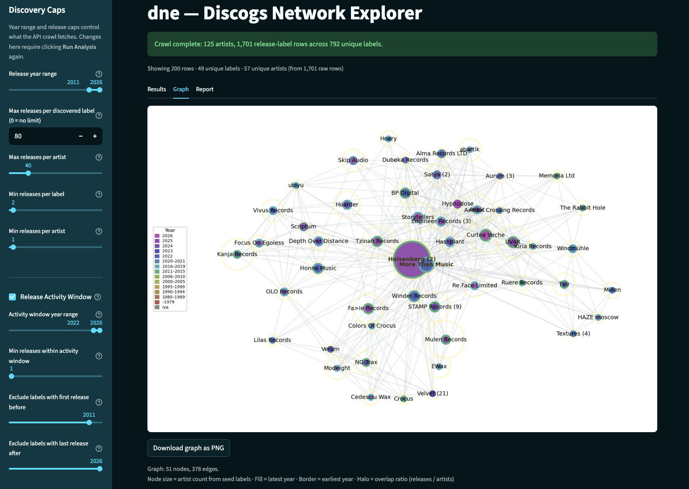

# dne — Discogs Network Explorer



greetings,

music has the capacity to create profoundly powerful experiences, moments, spaces, and communities..yet I have had many periods in recent years where I didn't have the energy to search for new music because the process made me feel lost..I am sure many of us get plenty enough of that feeling from various other aspects of the world we live in. I made this tool to find inspiration to look for music and to have hope/trust in what is found..and use that wonderful energy to create spaces for healing, growth, unity, and resistance against elitism.

the idea, or the way I use dne anyway, is to pick music labels or artists that I 'trust'..to collaborate with like-minded artists who lift up local communities, talents, spaces, advocate for unity, and oppose elitism.

to find new music, provide 'trusted' inputs in the form of artist and/or label IDs on from discogs.com (an accessible, fairly comprehensive database for music releases, both old and new). dne will pool all associated artists with your inputs and find new labels that host multiple (or many) of the input artists. in effect, with just a search or two, you can use dne to map semi-local communities centered around a particular sound house with shared values..and enjoy/support their work!


## what you need

- Python 3.10 or newer
- a free [Discogs personal access token](https://www.discogs.com/settings/developers), unless you only use the local database

## install

```bash
git clone https://github.com/n7cody/discogs-network-explorer.git
cd discogs-network-explorer
pip install -e .
```

this installs `dne`, which opens the app in your browser, and `dne-db-update`, which builds the optional local database.

## run the app

```bash
dne
```

the app opens in your browser. it runs on `localhost` only, so other devices on your network cannot reach it.

paste your Discogs token into the Authentication field in the sidebar. to skip this step next time, save it in a `.env` file in your home folder or the folder you run `dne` from:

```
DISCOGS_TOKEN=your_token_here
```

dne reads only `DISCOGS_TOKEN` from `.env` and ignores anything else in the file.

choose your inputs and settings, then click Run Analysis.

## data source

dne can read Discogs data from the live Discogs API or from a local database built on your machine.

with no local database, the app uses the Discogs API and the sidebar suggests running `dne-db-update` in a terminal. once a local database exists, the Data Source section in the sidebar lets you pick local database or Discogs API (default = local database).

- Local database is instant and works offline. it shows its database date, the date of the Discogs release it was built from.
- Discogs API is live and current but slow, about one request per second.

the Discogs token field and the HTTP cache settings appear only in Discogs API mode. the local database needs no token.

in Discogs API mode, Enable HTTP cache keeps successful responses for 24 hours in `discogs_cache.sqlite`, in the folder you run `dne` from. this makes repeat runs fast. use Clear cache if you want fresh data or see unexpected errors.

## search

there are three ways to search:

- Labels Only finds labels that share artists with your labels
- Labels + Artists does the same but keeps only labels that also have the artists you name
- Artists Only finds labels that host several of the artists you name

enter label and artist IDs from discogs.com as numbers, separated by commas or new lines. up to 500 IDs are accepted.

in Discogs API mode, the release caps keep the number of requests manageable, so results may represent a subset of the discoverable data. in local database mode, this is not a limitation.

## results and downloads

after a run, the Result Filters in the sidebar narrow the results without fetching again. you can filter by year, label size, format, country, artist role, genre and style. the year filter starts from the input release year range you searched with.

the Results tab has Download results (CSV), a ZIP of these files:

- `input_info.csv` holds your inputs, search settings, the data source with its database date if local, and the artist list
- `all_releases.csv` holds every release row found
- `discovered_labels.csv` has one row per label with its shared artists, release counts and years, plus its concentration in local database mode
- `excluded_labels.csv` lists the labels left out by Cap catalog size, when it is on

the Report tab bundles the graph PNG and the same CSV files into one ZIP.

## dnx playlists

dnx builds YouTube or Apple Music playlists from labels or artists you found with dne, and appears at the bottom of the app after you run an analysis.

pick a platform at the top of the dnx section:

- YouTube uses the video links already on Discogs release pages. search fallback, off by default, looks up releases without links.
- Apple Music searches the Apple Music catalog for every track. search fallback is on by default.
- Apple+YT tries Apple Music first and puts tracks it cannot find into a YouTube playlist instead.

you can enter label names from your current search results, label IDs or artist IDs, plus a year range to filter results by release data. dnx will make a playlist of up to 400 items from all of your inputs.

dnx attempts to find close matches to track information provided in youtube and apple music libraries, and will ask you to review uncertain results. tracks it could not find can be downloaded as `dnx_unobtained.csv`.

### YouTube setup

dnx uses the YouTube Data API, which needs a free Google Cloud project. you only need to do this once.

1. open the [Google Cloud Console](https://console.cloud.google.com/) and create a new project with any name
2. open [APIs & Services Library](https://console.cloud.google.com/apis/library), search for YouTube Data API v3 and click Enable
3. open the [OAuth consent screen](https://console.cloud.google.com/apis/credentials/consent), choose External and click Create
4. fill in the app name and your email address, leave the other fields blank and skip the Scopes step
5. in the Audience tab, add your own Google email address under Test users
6. open [Credentials](https://console.cloud.google.com/apis/credentials), click Create Credentials, then OAuth client ID
7. choose Desktop app as the application type, give it any name and click Create
8. click Download JSON and save the file as `~/client_secret.json`, or anywhere you like
9. in the dnx section, enter the path to that file and click Connect YouTube
10. sign in to Google in the browser window that opens and allow access

YouTube gives you a free daily allowance. dnx finds most videos through links already on Discogs, so the allowance is spent mostly on building the playlist. a playlist of 100 videos uses about half of it.

### Apple Music setup

dnx uses Apple's MusicKit, which needs a paid [Apple Developer Program](https://developer.apple.com/programs/) membership. you only do this once. the full steps and the helper page are in [`apple_music_setup.txt`](apple_music_setup.txt).

1. in your [Apple Developer account](https://developer.apple.com/account), open Identifiers and register a new Media ID with MusicKit checked
2. open Keys, create a new key with MusicKit checked and link it to that Media ID
3. download the `.p8` key file. you can download it only once
4. note your Team ID, shown at the top right of the portal, and the Key ID, shown on the key page
5. follow `apple_music_setup.txt` to get a Music User Token in Safari
6. in the dnx section, select Apple Music, enter your Team ID, Key ID, the path to the `.p8` file and the Music User Token
7. click Connect Apple Music

set the storefront to the country of your Apple Music subscription, for example `us`, `gb` or `de`. the app renews the developer token from your `.p8` key on its own. if playlist creation starts failing, get a new Music User Token.

## local database

the local database is a copy of the monthly-released Discogs database which you can download with `dne-db-update`. once downloaded, searches run in seconds with no network needed. periodic running of `dne-db-update` will ensure that your database remains up-to-date for the current month (and old databases are removed after the new database is obtained)

to build it, run in a terminal:

```bash
dne-db-update
```

the first build takes about 80 minutes plus download time. it needs up to 40 GB of free disk while it runs and about 10 GB once built.

the database goes in `~/.dne/discogs_db` by default. to put it somewhere else, set `DNE_DB_PATH` or pass `--db-path`. 

`dne-db-update --help` for a list of options.

## update dne

```bash
git pull
pip install -e .
dne-db-update  # optional, refreshes the local database
```

## stored credentials

your YouTube token and Apple Music settings are saved in `~/.dne/`, readable only by you.

## privacy policy

see [privacy_policy.md](privacy_policy.md) for how dne and dnx handle data and credentials.

## development

```bash
pip install -e ".[dev]"
pytest
```

`dne-db-update` also takes `--date YYYYMMDD` to build a specific database version, `--force` to rebuild, `--keep-downloads` to keep the downloaded files, `--limit N` for a quick partial build and `--memory-limit SIZE` to cap memory use.
